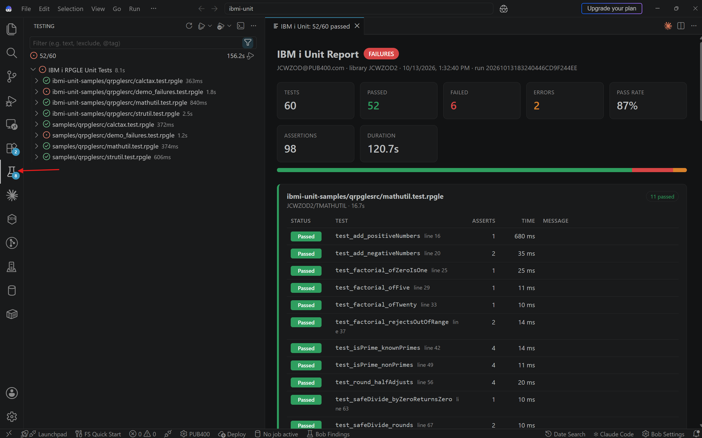
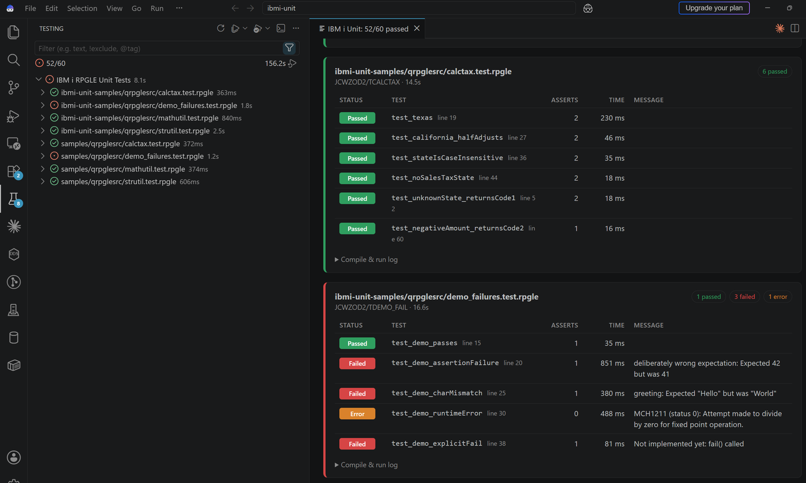
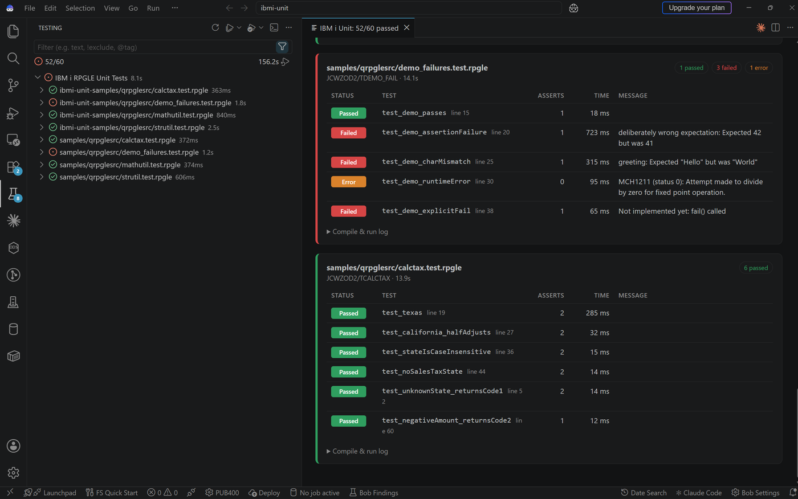
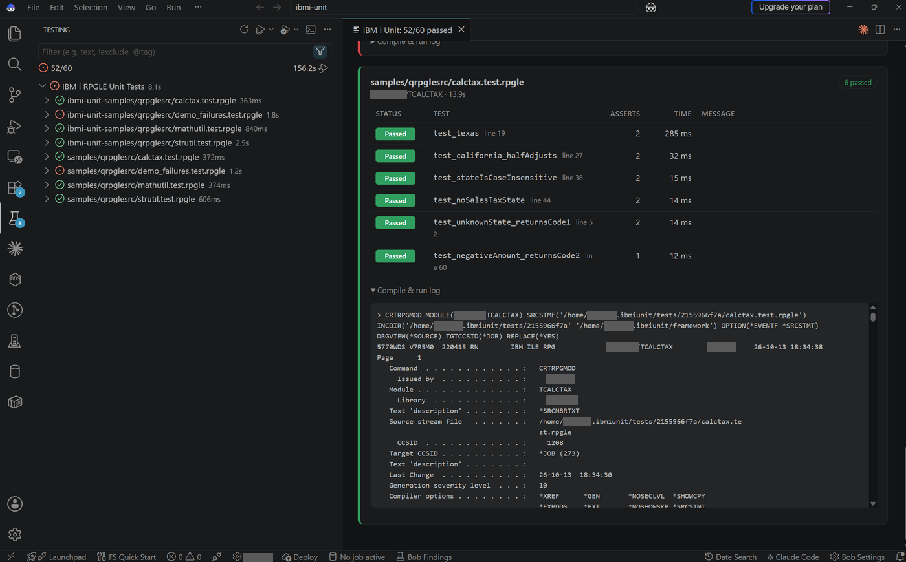
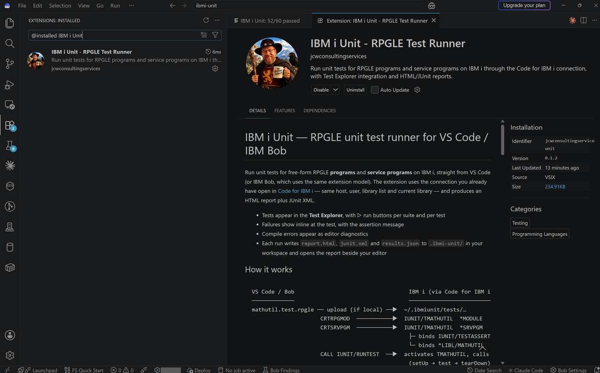

# IBM i Unit — RPGLE unit test runner for VS Code / IBM Bob

Run unit tests for free-form RPGLE **programs** and **service programs** on IBM i, straight from VS Code (or IBM Bob, which uses the same extension model). The extension uses the connection you already have open in [Code for IBM i](https://marketplace.visualstudio.com/items?itemName=HalcyonTechLtd.code-for-ibmi) — same host, user, library list and current library — and produces an HTML report plus JUnit XML.

- Tests appear in the **Test Explorer**, with ▷ run buttons per suite and per test
- Failures show inline at the test, with the assertion message
- Compile errors appear as editor diagnostics
- Each run writes `report.html`, `junit.xml` and `results.json` to `.ibmi-unit/` in your workspace and opens the report beside your editor

## Screenshots

The sample suites running on PUB400 from IBM Bob. `demo_failures.test.rpgle` fails on purpose to show how failures and runtime errors are reported.

**Test Explorer and the HTML report**



**Passing and failing suites in the report**



**Assertion messages and runtime errors**



**Compile & run log for each suite**



**The extension in IBM Bob**



## How it works

```
VS Code / Bob                                   IBM i (via Code for IBM i)
─────────────                                   ─────────────────────────
mathutil.test.rpgle ── upload (if local) ──▶  ~/.ibmiunit/tests/…
                     CRTRPGMOD  ───────────▶  IUNIT/TMATHUTIL  *MODULE
                     CRTSRVPGM  ───────────▶  IUNIT/TMATHUTIL  *SRVPGM
                                                ├─ binds IUNIT/TESTASSERT (assertions)
                                                └─ binds *LIBL/MATHUTIL   (code under test)
                     CALL IUNIT/RUNTEST  ──▶  activates TMATHUTIL, calls each TEST_* export
                                                (setUp → test → tearDown), writes IUNITRES
Test Explorer + report ◀── SELECT … FROM IUNIT.IUNITRES WHERE RUNID = …
```

The IBM i side is a small framework the extension installs for you:

| Object | Type | Purpose |
|---|---|---|
| `TESTASSERT` | *SRVPGM, ACTGRP(*CALLER) | Assertions (`assertEqualsInt`, `assertEqualsChar`, …) |
| `RUNTEST` | *PGM, ACTGRP(*NEW) | Activates a test service program and calls its exported tests by name (`QleActBndPgm` / `QleGetExp`) |
| `IUNITRES` | Table | One row per test result, keyed by run ID |

Each run gets a fresh activation group, so recompiled code is always picked up.

## Install

1. Install **Code for IBM i** and connect to your system.
2. Install the extension: *Extensions* view → `…` → **Install from VSIX…** → `ibmi-unit-0.1.0.vsix`. (In IBM Bob the menu is the same.)
3. Run **IBM i Unit: Install Test Framework on IBM i** from the Command Palette. The library `IUNIT` (configurable via `ibmiUnit.library`) must already exist on the IBM i — the extension does not create libraries. It builds `TESTASSERT`, `RUNTEST` and `IUNITRES`. You are also prompted automatically on the first test run.

Requirements on the IBM i: 7.3 or later, ILE RPG and SQL compilers (`CRTSQLRPGI`), and QSH (`/QOpenSys/usr/bin/qsh`, used for `liblist` and `system`). The framework library and any sample library must be created beforehand by someone with `CRTLIB` authority; you need *CHANGE authority to them.

## Try the samples

Run **IBM i Unit: Build Sample Programs on IBM i**. It asks for an existing library (default `IUNITSAMP`), compiles the sample code under test there, and copies the sources into `ibmi-unit-samples/qrpglesrc/` in your workspace:

| Source | Object | What it shows |
|---|---|---|
| `mathutil.rpgle` + `mathutil_h.rpgleinc` | *SRVPGM MATHUTIL | add, factorial, isPrime, half-adjust rounding, safe divide |
| `strutil.rpgle` + `strutil_h.rpgleinc` | *SRVPGM STRUTIL | reverse, padLeft, capitalize, count occurrences |
| `calctax.rpgle` | *PGM CALCTAX | a program with parameters, called via `EXTPGM` |
| `mathutil.test.rpgle` | test suite | 11 tests against a service program |
| `strutil.test.rpgle` | test suite | 8 tests, plus `setUp`/`tearDown` hooks |
| `calctax.test.rpgle` | test suite | 6 tests against a *PGM |
| `demo_failures.test.rpgle` | test suite | **fails on purpose** — shows FAILED and ERROR results |

Open Test Explorer (beaker icon) and press ▷, or open any `.test.rpgle` file and use the ▷ in the editor title bar.

## Writing tests

A test suite is a `NOMAIN` module. Every procedure with `EXPORT` whose name starts with `test` is a test.

```rpgle
**free
//#BNDSRVPGM: *LIBL/MATHUTIL
//#LIBL: MYLIB
ctl-opt nomain;

/include 'testassert.rpgleinc'
/include 'mathutil_h.rpgleinc'

dcl-proc setUp export;              // optional, runs before each test
end-proc;

dcl-proc test_add export;
  assertEqualsInt(5: math_add(2: 3): 'math_add(2: 3)');
end-proc;
```

To test a `*PGM`, prototype it with `EXTPGM` in the test and call it — see `calctax.test.rpgle`.

### Assertions

| Procedure | Passes when |
|---|---|
| `assertTrue(cond [: msg])` / `assertFalse(cond [: msg])` | indicator is `*ON` / `*OFF` |
| `assertEqualsInt(expected: actual [: msg])` | integers equal (int(20)) |
| `assertEqualsDec(expected: actual [: msg])` | decimals equal (packed(31:9)) |
| `assertEqualsChar(expected: actual [: msg])` | strings equal, trailing blanks ignored |
| `assertNotEqualsChar(unexpected: actual [: msg])` | strings differ |
| `fail(msg)` | never — fails the test |

The first failing assertion ends the test with status **FAILED**. Any other exception (for example `MCH1211` divide by zero) gives **ERROR**. A requested test that is not exported gives **MISSING**.

### Hooks

`setUp`, `tearDown` (per test) and `setUpSuite`, `tearDownSuite` (once per run) are called when they are exported. If `setUpSuite` fails, every test in the suite is reported as ERROR.

### Directives

Comment lines in the test source tell the extension how to build and run it:

| Directive | Effect |
|---|---|
| `//#BNDSRVPGM: LIB/OBJ OBJ2` | Bind service programs (no library → `*LIBL`) |
| `//#BNDDIR: LIB/DIR` | Bind binding directories |
| `//#LIBL: LIB1 LIB2` | Add libraries to the library list for compile and run |
| `//#INCDIR: /path/one, /path/two` | Extra IFS include directories |
| `//#TESTOBJ: TMYSUITE` | Name of the compiled test service program (default: `T` + file name, 10 chars) |

## Where the source can live

| Opened as | How it is compiled |
|---|---|
| Local workspace file | Uploaded to `~/.ibmiunit/tests/<folder>/` along with `*.rpgleinc` files beside it, then `SRCSTMF` |
| IFS stream file (Code for IBM i) | Compiled in place with `SRCSTMF`; its folder is on `INCDIR` |
| Source member (Code for IBM i) | `SRCFILE`/`SRCMBR`; use `/copy` for your own copybooks — the framework copybook still resolves through `INCDIR` |

`.sqlrpgle` test suites are compiled with `CRTSQLRPGI OBJTYPE(*MODULE)`.

## Settings

| Setting | Default | |
|---|---|---|
| `ibmiUnit.library` | `IUNIT` | Framework + compiled suites |
| `ibmiUnit.remoteDirectory` | `~/.ibmiunit` | IFS working folder |
| `ibmiUnit.additionalLibraries` | `[]` | Added on top of the Code for IBM i library list |
| `ibmiUnit.testFileGlob` | `**/*.test.{rpgle,sqlrpgle,…}` | Workspace discovery |
| `ibmiUnit.reportFolder` | `.ibmi-unit` | Report output |
| `ibmiUnit.openReportAfterRun` | `true` | |
| `ibmiUnit.keepResultsDays` | `7` | Housekeeping for `IUNITRES` |

## Reports and CI

`junit.xml` follows the common JUnit schema, so Jenkins, GitLab, Azure DevOps and GitHub test reporters can read it. `results.json` holds the raw run data.

## Build from source

```bash
npm install
npm run compile
npx @vscode/vsce package --allow-missing-repository
```

Press **F5** in VS Code to launch an Extension Development Host.

## Troubleshooting

- **Library does not exist** — the extension does not create libraries. Have someone with `CRTLIB` authority create the framework library (`ibmiUnit.library`) and any sample library first.
- **RNS9380 / "Unable to open file" on `CRTSQLRPGI`** — fixed in 0.1.2: `TGTCCSID(*JOB)` is now passed through `COMPILEOPT` for UTF-8 stream files.

- **"Not connected to an IBM i"** — connect in Code for IBM i first; the extension never opens its own connection.
- **Compile failed** — messages from the compiler event file are shown in the report and as editor diagnostics; the full command output is in the *IBM i Unit* output channel and the report's *Compile & run log*.
- **MISSING** — the procedure exists in the source but isn't exported; add `EXPORT` to the `DCL-PROC`.
- **Signature violation after reinstalling the framework** — suites are recompiled on every run, so just run again.
- **`CPF9898` in the job log** — expected: that is how a failing assertion stops the test.

## Changelog

- **0.1.3** — Screenshots in the README; `PROMPTS.md` records the prompts behind each version.
- **0.1.2** — `CRTSQLRPGI` passes `TGTCCSID(*JOB)` through `COMPILEOPT`, fixing RNS9380 on UTF-8 source.
- **0.1.1** — No longer runs `CRTLIB`; checks that the library exists instead. `liblist` now runs under QSH. Extension icon added.
- **0.1.0** — First release.
